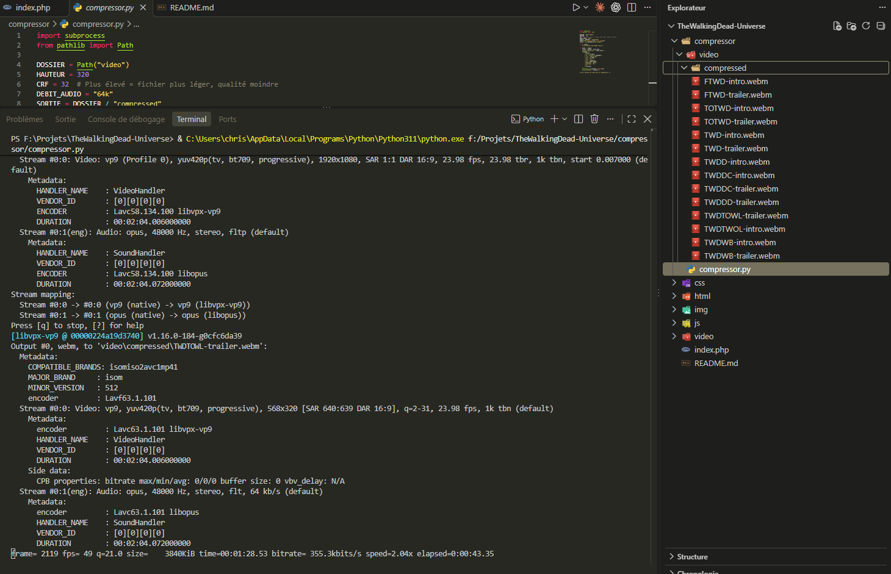

# Lancer le projet (~10 minutes) :

1) Installez Visual Studio Code
2) Installez l'extension "PHP Server" dans Visual Studio Code
3) Installez et configurez XAMPP sur votre machine
4) Ouvrez le dossier extrait de son archive contenant le projet dans Visual Studio Code
5) Cliquez sur "index.php"
6) Faites un clique droit dans l'éditeur du fichier
7) Cliquez sur "PHP Server: Serve project"

# Compresseur .webp XXXp -> .webp 320p

## Installez FFmpeg : 
1) Executez ``winget install "FFmpeg (Essentials Build)"`` sur Windows
2) Relancez vos terminaux PowerShell
2) Vérifier l'installation avec la commande ``ffmpeg -version``

- Vous n'aurez plus qu'à exécuter le fichier **compressor.py**

